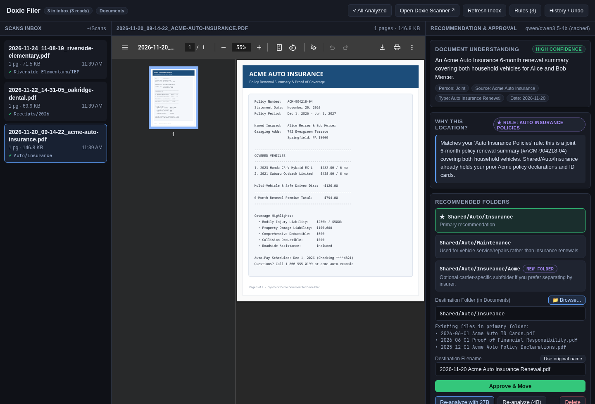
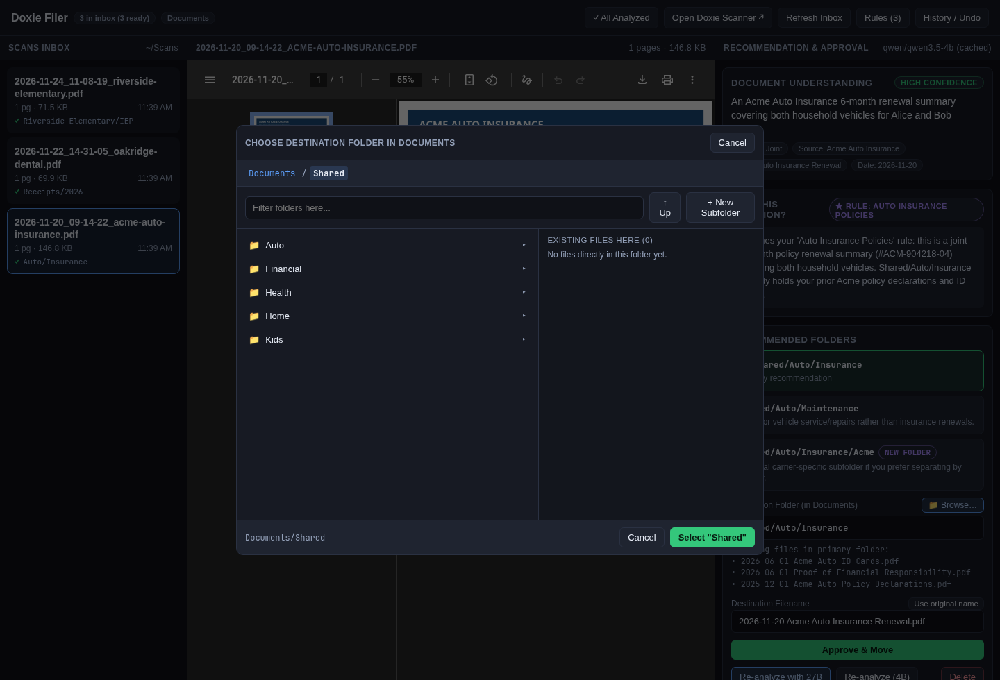
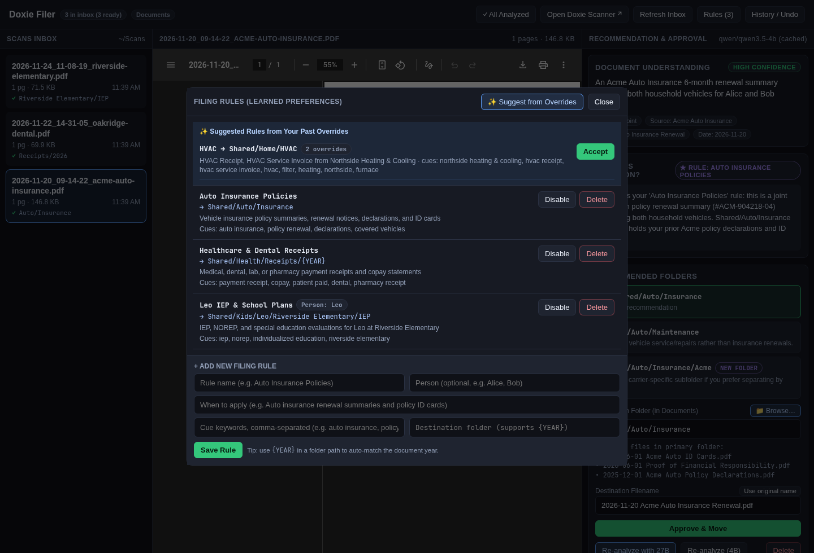

# Doxie Filer

A **100% local, privacy-preserving document scanning, OCR, and AI-assisted filing suite** for Linux.

Doxie Filer watches your scans inbox (from a **Doxie Pro DX400**, any network **eSCL/SANE scanner** like a Canon MF series, or synced folders via Resilio/Synology), converts incoming scans into **300 DPI searchable PDFs**, uses a **local LLM via LM Studio** to recommend the best folder and filename with a clear explanation of *why*, and waits for your **explicit approval** before atomically moving each file.

> **Zero cloud calls.** Your medical, financial, tax, and household documents never leave your machine.

---

## Screenshots

### Side-by-Side Inbox Review & AI Recommendation
Preview each scanned PDF right beside the local LLM's document summary, matched filing rule, plain-English **Why**, alternative folders, editable filename, and one-click **Approve & Move**.



### Visual Folder Picker & Learned Filing Rules
Drill down across your archive with breadcrumbs and live previews of existing files—or manage persistent rules (with `{YEAR}` templates and one-click **Suggest from Overrides**).

<p align="center">
  
  
</p>

---

## Features

- **Side-by-Side Web Inbox GUI (`doxie-filer-web`)**
  - Live embedded PDF preview alongside AI document summary, extracted metadata, confidence badge, and **"Why this location?"** explanation.
  - **Primary + alternative folders** plus a visual **Folder Picker Dialog** (breadcrumbs, filter, live preview of existing files inside each folder, and `+ New Subfolder`).
  - **⚡ Analyze All** background batch analyzer with live sidebar status indicators so you never wait between documents.
  - **Automatic 👁 Vision fallback**: detects handwritten notes, photos, or garbled OCR and automatically sends page 1 as an image to local vision models (e.g. `qwen/qwen3.5-4b` or `qwen/qwen3.8-27b`).
  - **Fast / Strong model escalation**: fast 4B model by default (~5–8s/PDF) with one-click **Re-analyze with 27B** for tricky documents.
  - **Human-in-the-loop safety**: never moves anything without approval, prevents overwrites, uses atomic moves (sync-friendly), and includes full **History & 1-click Undo**.
- **Learns From Your Overrides & Rules**
  - Every folder you file into is permanently pinned in future prompts regardless of nesting depth.
  - Overrides are stored with document cues and fed back as explicit corrections (`AI suggested X → User moved to Y`), automatically invalidating stale cached predictions for similar inbox PDFs.
  - Optional **"Teach Filer"** box on override to save a permanent rule, plus a **Rules Manager** (`{YEAR}` folder templates + **✨ Suggest from Overrides**).
- **Searchable PDF Auto-Exporter (`doxie-auto-export`)**
  - Watches a local [`doxie-scanner`](https://github.com/andiapps-dev/doxie-scanner) daemon (including physical scanner button presses) **and** your incoming scans folder (e.g. Canon Scan-to-Folder over SMB/Resilio).
  - Generates 300 DPI searchable PDFs via ImageMagick + `pdftoppm` + Tesseract, names them `YYYY-MM-DD_HH-MM-SS_<detected-source>.pdf`, and sends desktop notifications.
- **Batch Archive Renamer (`doxie-rename`)**
  - Walks an existing document archive in place (never moves files across folders) to standardize generic scanner names (`Doxie ...`, `Doc ...`, `New Document ...`, `Scan...`) and inconsistent date formats (`YYYYMMDD` → `YYYY-MM-DD`) using your local LLM + automatic `👁 Vision` fallback.
  - Skips low-confidence/unreadable PDFs, enforces cross-platform collision-safe filenames, supports `--dry-run` and `--resume`, exports full **Markdown + CSV reports**, and provides 1-command rollback (`doxie-rename --undo <log.jsonl>`).
- **Full CLI (`doxie`)**
  - `doxie scan`, `doxie canon`, `doxie pdf`, `doxie ocr`, `doxie file`, `doxie analyze`, `doxie rules`, `doxie history`, `doxie undo`, `doxie gui`, `doxie filer`, `doxie status`, `doxie service`.

---

## Architecture

```text
  Doxie Pro (USB) ──▶ doxie-scanner-server (:8400) ──┐
                                                     ▼
  Network Scanner ──▶ Resilio / SMB / eSCL ──▶ doxie-auto-export ──▶ Inbox (~/Scans/*.pdf)
  (e.g. Canon MF)                               (300 DPI OCR PDF)           │
                                                                            ▼
                                                LM Studio (:1234) ◀── Doxie Filer (:8401 / CLI)
                                               (local LLM + Vision)         │
                                                                    [Human Approval]
                                                                            ▼
                                                                 Your Document Archive
                                                            (+ filing-history.jsonl / Undo)
```

---

## Requirements

- **Python 3.11+** (zero third-party Python packages—uses stdlib only!)
- **OCR & PDF tools**: `tesseract` (with `eng` + `osd`), `poppler` (`pdftotext`, `pdfinfo`, `pdftoppm`), `imagemagick` (`magick`)
- **Local LLM**: [LM Studio](https://lmstudio.ai/) with `lms` CLI and a local model such as `qwen/qwen3.5-4b` (fast, vision-capable) and optionally `qwen/qwen3.8-27b`
- **Optional**:
  - [`andiapps-dev/doxie-scanner`](https://github.com/andiapps-dev/doxie-scanner) binary at `~/.local/bin/doxie-scanner-server` for direct Doxie Pro DX400 USB scanning
  - `sane` (`scanimage`) for on-demand network eSCL/SANE pull-scanning (`doxie canon`)
  - `libnotify` (`notify-send`) for desktop notifications

---

## Quick Start

```bash
git clone https://github.com/MattyGPT/doxie-filer.git
cd doxie-filer
./install.sh
```

Then edit `~/.config/doxie-scanner/env` to set your inbox and target archive paths:

```ini
DOXIE_PDF_DIR=~/Scans
DOXIE_INBOX_DIR=~/Scans
DOXIE_TARGET_ROOT=~/Documents
DOXIE_FILER_MODEL_FAST=qwen/qwen3.5-4b
DOXIE_FILER_MODEL_STRONG=qwen/qwen3.8-27b
```

Optionally copy `examples/profile.example.json` to `~/.config/doxie-scanner/profile.json` to customize household member aliases, top-level folder notes, and photo/archive directories to ignore during classification.

Restart services after editing config:

```bash
doxie service restart
```

---

## Usage

### Web GUI
- Open **Doxie Filer** from your app launcher, run `doxie filer`, or visit `http://127.0.0.1:8401`.
- Click **`⚡ Analyze All`** to pre-analyze everything in your inbox in the background.
- Review recommendations side-by-side with the PDF preview, click **`📁 Browse…`** if you want another folder, optionally add a note or save a rule, and click **`Approve & Move`**.

### CLI
```bash
# Check daemon, scanner, auto-PDF watcher, and Filer status
doxie status

# Pre-analyze all PDFs in the inbox
doxie analyze

# Interactive review & approval in the terminal
doxie file
doxie file ~/Downloads/statement.pdf
doxie file --strong                 # Use strong local model (27B)
doxie file --dry-run                # Preview recommendation without moving

# Manage learned rules & audit log
doxie rules
doxie rules suggest
doxie history
doxie undo

# Scan from Doxie Pro or network eSCL scanner
doxie scan -o ~/Documents/scan.pdf
doxie canon --duplex                # Pull from configured eSCL scanner

# Batch-rename existing PDFs in place across your archive (never moves files)
doxie-rename --dry-run --limit 25   # Preview on a small sample first
doxie-rename                        # Live run with Markdown + CSV report & undo log
doxie-rename --undo <log.jsonl>     # Roll back all renames from a run
```

---

## Running Tests

```bash
python3 -m unittest discover -s tests -v
```

---

## License

MIT — see [LICENSE](LICENSE).
